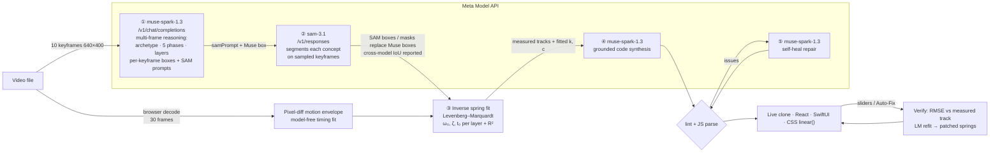

# MotionClone — turn a screen recording into spring-physics UI code

**Meta Global AI Developer Hackathon 2026 · Push the Frontier (Software) · built on Meta Model API: `muse-spark-1.3` + `sam-3.1`**

> Designers ship motion as videos. Engineers re-implement it by eye, guessing `stiffness: 300, damping: 20` until it "feels close".
> **MotionClone measures the motion instead.** Drop in any `.mp4 / .mov / .webm` of a UI animation and get a running clone plus React (Framer Motion), SwiftUI and CSS code whose spring constants were **fitted to the video**, with a fidelity score that tells you how close they are.

```bash
npm run dev          # from the repo root: installs the Studio and serves http://localhost:3000
```
Then click **Set Meta API Key** and **Upload Any UI Video**. To try it without a key, pick a built-in example from the dropdown. Examples use synthetic reference telemetry.

---

## How it works: a closed loop between two Meta models



| Stage | Model / method | What actually flows to the next stage |
|---|---|---|
| ① Perceive | `muse-spark-1.3` with 10 frames | Archetype, title, 5-phase breakdown, ≤4 moving layers, each with a `samPrompt` and a measured `[x,y,w,h]` box **per keyframe** |
| ② Segment | `sam-3.1` (5 keyframes × each layer, concurrency 5) | SAM boxes and mask outlines **replace** Muse's estimates on those frames. Muse's box is used to disambiguate xyxy/xywh and to reject the wrong instance. Mean **SAM↔Muse IoU** is surfaced in the UI as a cross-model agreement score |
| ③ Identify | Levenberg–Marquardt (TypeScript, shared by server and browser) | Per-layer ω₀, ζ, onset t₀, R², RMSE, all computed from the fused tracks (no hard-coded fits) |
| ④ Synthesize | `muse-spark-1.3` with frames + the measured table | Self-contained HTML clone that reads springs from `window.MC_SPRING`, plus a Framer Motion component that uses the fitted constants |
| ⑤ Self-heal | Static lint + `new Function` parse, then `muse-spark-1.3` repair | Truncation, `NaN` path data, missing animation driver, and JS syntax errors are fixed before anyone sees them. Runtime errors inside the preview iframe are reported back and can be repaired in one click |

Every stage streams progress to the UI as NDJSON, so you can watch each model hand off to the next.

## The math

Each tracked layer's motion is projected onto its dominant start→rest direction in (cx, cy, w, h) space. That gives normalized progress u(t), with overshoot past the rest state preserved. Clips that expand and then collapse are windowed to the outbound transition. The model is the unit-step response of the damped harmonic oscillator:

$$\ddot u + 2\zeta\omega_0\dot u + \omega_0^2\,(u-1) = 0,\qquad u(t_0)=\dot u(t_0)=0$$

$$u(t)=1-e^{-\zeta\omega_0\tau}\Big(\cos\omega_d\tau+\tfrac{\zeta}{\sqrt{1-\zeta^2}}\sin\omega_d\tau\Big),\quad \tau=t-t_0,\ \omega_d=\omega_0\sqrt{1-\zeta^2}$$

The critically damped and overdamped closed forms are used for ζ ≥ 1. The fit is a coarse 18×16×14 grid search over (ω₀, ζ, t₀) followed by Levenberg–Marquardt with a central-difference Jacobian (`frontend/src/lib/springFit.ts`). Recovered constants map to every target:

| Target | Mapping |
|---|---|
| Framer Motion | `stiffness = mω₀²`, `damping = 2ζω₀m` |
| SwiftUI | `.interpolatingSpring(mass:stiffness:damping:)` (exact, not an approximation) |
| CSS | `transition-timing-function: linear(…)` sampled from u(t), so overshoot and ringing survive (`cubic-bezier` cannot oscillate) |

**Verify Match** computes RMSE between the candidate spring and the measured samples (fidelity = 1 − RMSE). **Auto-Fix** re-runs Levenberg–Marquardt, seeded from the candidate, and patches the sliders, the live preview (`window.MC_SPRING`) and all three exports at once.

Sanity check: on synthetic step responses with ±1% noise, the solver recovers ω₀ and ζ to within ~2% (R² ≥ 0.9995) across underdamped, near-critical and overdamped cases.

## Robustness

- **Any container:** decoding happens in the browser. WebM from MediaRecorder (duration = ∞) is handled. HEVC/ProRes `.mov` files the browser cannot decode fail in under a second with an exact re-export command, never an infinite spinner. Seeking keeps working in background tabs.
- **SAM 3.1 wire format:** `/v1/responses` returns detections as tokens in `output_text` (`<|box;x1=…;y1=…;x2=…;y2=…;w=…;h=…|><|mask;…|>`, one per instance; empty text = no match). SAM matches plain visual nouns ("black rounded rectangle", "green circle"), not UI jargon, so Muse writes SAM-friendly prompts plus a bare-shape fallback that is retried when the first finds nothing.
- **Untrusted model output:** boxes are sanitized (finite, on-stage), JSON is extracted by brace matching, and code fences are matched by exact language tag.
- **Never blank:** if synthesis fails, a deterministic renderer replays the measured keyframe boxes with the fitted springs.
- **Preview fit:** generated documents are measured inside the iframe and scaled down if they would clip.

## Repository layout

```
frontend/                       Next.js 15 Studio (the product — run this)
  src/app/api/analyze-video     streaming 5-stage pipeline (NDJSON)
  src/app/api/refine-with-spark "Ask Muse Spark" edits + runtime-error repair
  src/lib/server/metaPipeline   Muse ⇄ SAM orchestration, SAM response parsing, prompts, self-heal
  src/lib/springFit.ts          grid + Levenberg–Marquardt spring identification
  src/lib/trackFusion.ts        tracks → progress → fitted TrackedLayer
  src/lib/videoFrameAnalyzer.ts browser decode, keyframes, pixel-diff motion envelope
  src/lib/codegen.ts            React / SwiftUI / CSS linear() exporters
backend/                        optional FastAPI + SciPy reference implementation (not used by the Studio)
```

## Configuration

The Studio needs only a key. Paste it in the UI (stored in your browser's localStorage), or set it server-side:

```bash
cp .env.example frontend/.env.local   # MODEL_API_KEY, META_BASE_URL, MUSE_MODEL_ID, SAM_MODEL_ID
```

Optional tuning: `SAM_FRAMES_PER_LAYER` (default 5), `SAM_CONCURRENCY` (default 5), `MOTIONCLONE_DEBUG=1` (writes `/tmp/motionclone_debug.json`).
